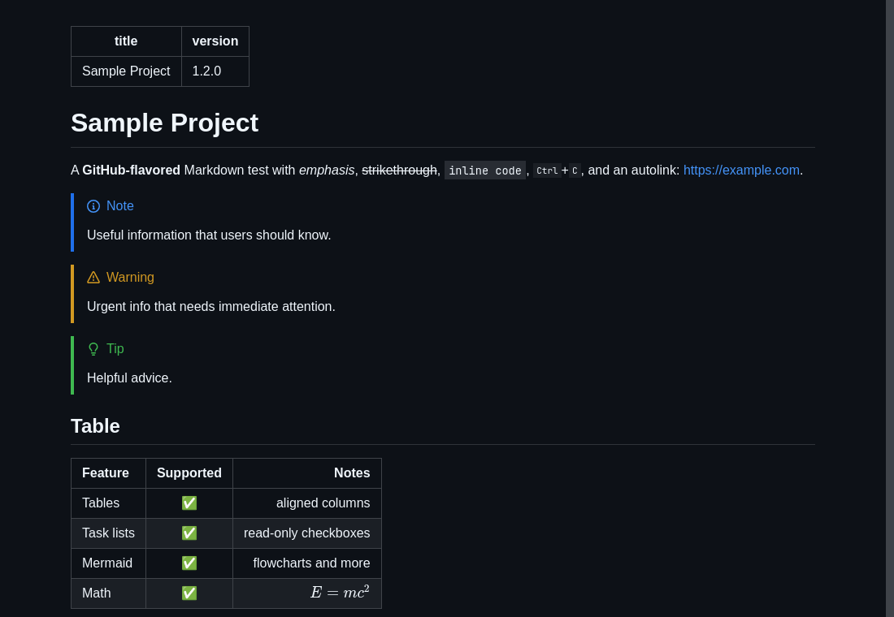

# MD View



MD View shows Markdown files the way GitHub renders them, in the colors of
your Omarchy theme. It keeps the page in sync with the file, so you can edit
in one window and read the result in another.

It renders everything GitHub-flavored Markdown has:

- tables with column alignment, task lists, strikethrough, and autolinks
- `> [!NOTE]`, `[!TIP]`, `[!IMPORTANT]`, `[!WARNING]`, and `[!CAUTION]` alerts
- footnotes, heading anchors, and YAML front matter (as a table)
- syntax-highlighted code in the theme's colors
- Mermaid diagrams (` ```mermaid `)
- math with `$inline$`, `$$display$$`, and ` ```math ` blocks
- raw HTML such as `<details>`, `<kbd>`, and ``, sanitized like
  GitHub does, so a document can't run scripts

Relative images and links resolve beside the file. Links to other Markdown
files open in MD View (Backspace goes back); web links open in your browser.

## Install

On Omarchy (or any Arch system with Qt 6):

```sh
git clone https://github.com/Mohit-Alive/Md-View.git
cd Md-View
bin/install
```

## Use

```sh
mdview README.md
```

Or pick **MD View** from the app launcher (`Super + Space`), or set it as the
default for Markdown files:

```sh
xdg-mime default mdview.desktop text/markdown
```

## Shortcuts

| Key | Action |
| --- | --- |
| `O` | Open a Markdown file |
| `E` | Edit this file in your editor (`omarchy launch editor`) |
| `R` | Reload |
| `T` | Show or hide the outline |
| `/` or `Ctrl+F` | Find in document |
| `J` / `K` | Scroll down or up |
| `D` / `U` | Half a page down or up |
| `Space` / `Shift+Space` | Next or previous page |
| `G` / `Shift+G` | Top or bottom |
| `Backspace` | Back to the previous file |
| `Ctrl +` / `Ctrl -` / `Ctrl+0` | Zoom in, out, or reset |
| `?` | Show every shortcut |
| `Q` | Quit |

## Build

```sh
bin/build      # build/mdview
bin/test       # Qt Test suite, offscreen
bin/install    # makepkg -fsi, so it lands in the launcher
```

It needs `qt6-base`, `qt6-declarative`, `qt6-wayland`, and `qt6-webengine`.
The page is rendered by Qt WebEngine from libraries bundled in the binary
(marked, DOMPurify, highlight.js, KaTeX, Mermaid, and GitHub's Markdown CSS);
their licenses are in `src/web/vendor/licenses/`.
